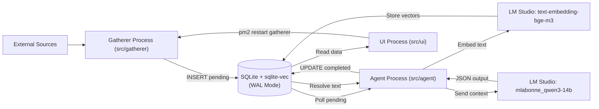

# Valet Architecture

## 1. Intelligence Pipeline

Valet runs on unified-memory hardware.
It connects to LM Studio at `http://localhost:1234/v1`.
The system strictly separates retrieval and reasoning models:

- **Retrieval Model (`text-embedding-bge-m3`):** Generates 1024-dimension vector embeddings.
- **Reasoning Model (`mlabonne_qwen3-14b-abliterated`):** Generates structured text answers.
- **Context Bridge:** The models use different vector spaces. The Agent converts vector matches to plain text. The Agent sends this plain text to the reasoning model.



---

## 2. Process Boundaries

PM2 runs three isolated processes.
The processes do not share memory.
They communicate only through the SQLite database file (`data/valet.db`).

| Process | File | Mode | Role and Boundaries |
| :--- | :--- | :--- | :--- |
| **`gatherer`** | `src/gatherer/index.ts` | One-shot (`cron_restart`) | Runs every 15 minutes. Reads active sources. Fetches external data. Writes `pending` rows to SQLite. Exits immediately after work. |
| **`agent`** | `src/agent/index.ts` | Continuous (`autorestart`) | Polls `pending` rows. Generates embeddings. Performs vector search. Calls the reasoning model. Writes `completed` status to SQLite. |
| **`ui`** | `src/ui/index.ts` | Continuous (`autorestart`) | Serves Express API and Vite React dashboard. Reads intelligence items from SQLite. Restarts gatherer on demand with PM2. |

### Process Isolation Rules

- **No Shared Memory:** Each process runs in its own Node.js runtime.
- **Database Boundary:** All data exchange happens through SQLite tables.
- **Trigger Boundary:** The UI triggers the gatherer only through PM2 command line calls.

---

## 3. SQLite WAL Concurrency and Vectors

Each process opens an independent `better-sqlite3` connection in `src/db/index.ts`.
Three settings manage concurrent database access:

1. **WAL Mode (`PRAGMA journal_mode = WAL;`):**
   - Readers do not block writers.
   - Writers do not block readers.
   - The UI reads data while the gatherer writes new rows.

2. **Busy Timeout (`PRAGMA busy_timeout = 5000;`):**
   - SQLite allows only one writer at a time.
   - Connections wait up to 5000 milliseconds for locks.
   - This setting prevents `SQLITE_BUSY` errors.

3. **Vector Extension (`sqlite-vec`):**
   - Every process loads `sqlite-vec` at startup.
   - The `content_embeddings` virtual table stores float32 vectors.
   - The agent queries this table with nearest-neighbor search.

---

## 4. File Structure

Valet uses a single root `package.json` file.
It does not use monorepo workspaces.

```text
ValetAI/
├── docs/architecture.md    # Architecture documentation
├── data/valet.db           # SQLite database with sqlite-vec
├── src/db/                 # Database connection and Zod schema
├── src/gatherer/           # One-shot data harvest worker
├── src/agent/              # Continuous vector and LLM worker
├── src/ui/                 # Express API and React dashboard
├── ecosystem.config.js     # PM2 process configuration
└── package.json            # Single dependency manifest
```
